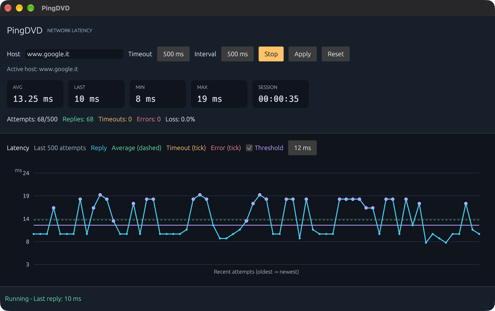

# PingDVD

Applicazione desktop in Rust per monitorare la latenza di rete con un grafico in tempo reale.



## Funzionalità

- Ping continuo di hostname e indirizzi IP.
- Grafico della latenza con media tratteggiata, storico di 500 campioni e scala automatica.
- Statistiche AVG, LAST, MIN e MAX e tempo trascorso della sessione.
- Configurazione di host, timeout e intervallo (1-100000 ms), con Start/Stop, Apply e Reset.
- Salvataggio automatico delle impostazioni in `pingdvd.settings.json` accanto all'eseguibile; se non scrivibile, usa la cartella di configurazione utente.
- Esecuzione del comando `ping` del sistema operativo per evitare privilegi ICMP elevati.

## Requisiti e compilazione

È necessario Rust stable con Cargo.

```bash
cargo run
cargo test
cargo build --release
```

Il workflow CI verifica Windows e macOS. Su macOS il bundle `PingDVD.app` usa l'icona in `assets/pingdvd.icns`.
